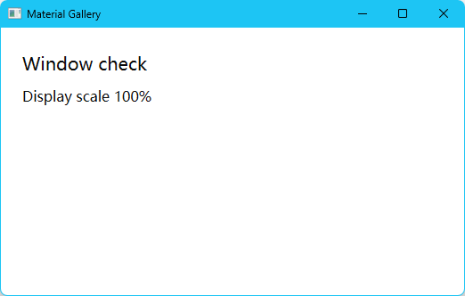
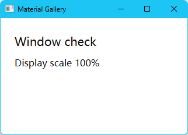

# P2 验收记录

验收日期为 2026-11-13。首版工程验收平台为 Windows 11 x64 MSVC。

## Windows 实窗

Windows 11 家庭版 build 26200，x86_64，GPUI Windows DirectX 后端。设备为 Ryzen 9 8945HX、32 GiB 内存和 RTX 5070 Laptop GPU（驱动 32.0.16.2114）。Rust/Cargo 1.99.1，MSVC 工具集 14.51.36231，Windows SDK 10.0.26100.0，WinApp CLI 0.7.1。

| 路径 | 观察 | 结果 |
| --- | --- | --- |
| `cargo build --locked -p gpui-material-gallery`，启动开发构建 | 标题栏为「Material Gallery」，正文显示「Window check」和「Display scale 100%」。Windows UI Automation 树读到同名 StatusBar。 | pass |
| 拖动窗口右下角，缩至最小尺寸 | UIA 窗口边界由 536×339 缩至 336×239，状态文字完整。 | pass |
| Alt+F4，另一次启动调用标题栏 Close 的 UIA InvokePattern | 两次均关闭真实窗口，进程退出码为 0。 | pass |
| `cargo test --locked --workspace --all-features` | Gallery 1 个 UI 集成测试及 xtask 4 个单元测试通过。 | pass |
| 独立 P1 清单，`cargo test --locked --manifest-path <清单>` | 宿主加 `--features test-support`，17 项通过，主题和形状各 3 项通过。 | pass |

运行入口和命令见[开发与验证](../development.md)。实机代码对应 [Workspace 与 Gallery 合并提交](https://github.com/wangdiandao/gpui-material/commit/802fb8b5afacffaf562972a6d827d92079c131ed)。

## Windows 构建基线

在干净的 [xtask 合并提交](https://github.com/wangdiandao/gpui-material/commit/2d4b1dcff4aa11885f3d356771d748b7394a830a) 上预取锁定依赖，然后运行 `cargo xtask timings target/timings/p2-baseline`。普通 Gallery feature，开发 profile，Cargo 自动选用 32 个作业。两项冷测各使用空目标目录，各自立即复用目录测热运行。

| 操作 | 冷耗时 | 热耗时 |
| --- | ---: | ---: |
| `cargo check` | 47.723 s | 0.585 s |
| `cargo build` | 62.664 s | 0.611 s |

冷检查和冷构建各处理 418 个编译单元。Cargo 时间线中的 Gallery 二进制检查单元为 0.2 秒，构建单元为 1.9 秒，后者包含代码生成与链接。另在热缓存上通过 `cargo rustc` 为 Gallery 二进制指定计时转发器，单次调用 MSVC `link.exe` 耗时 1.257 秒，Cargo 总耗时 2.22 秒。四份时间线保存在实机的 `target/timings/p2-baseline/`，同一命令可重建报告。

## GitHub Actions 与门禁

[首次托管验证](https://github.com/wangdiandao/gpui-material/actions/runs/43388732324)在 Windows Server 2025 build 26100 的 x64 MSVC runner 上通过全部检查。该次构建的开发版制品在跨机启动时触发 DirectX 的路径错误。固定 GPUI 后端在 debug assertions 开启时读取编译机 Cargo 注册表目录下的 HLSL 文件。[制品修复](https://github.com/wangdiandao/gpui-material/pull/63)使用 Windows SDK x64 `fxc.exe` 在编译时嵌入着色器。

[修复后的 Windows MSVC 运行](https://github.com/wangdiandao/gpui-material/actions/runs/43389985632)通过全部检查，并上传 [gallery-windows-x64-msvc](https://github.com/wangdiandao/gpui-material/actions/runs/43389985632/artifacts/14020542543)。在 Windows 11 实机下载并运行制品，UIA 读到「Display scale 100%」，调用标题栏 Close 后退出码为 0。下载制品中的 EXE SHA-256 为 `9ffb7016b00df18930bbc2c893700d9bd39e41d0238630e55ae8b35985673ff5`。

[Main Windows CI 规则集](https://github.com/wangdiandao/gpui-material/rules/27184646)已启用，适用于 `refs/heads/main`，无绕行角色。要求 PR、解决评审对话以及由 GitHub Actions 提供的最新主线 `Windows MSVC` 检查，阻止强推和分支删除。仓库只有一位协作者，本阶段执行逐项自审，规则集的批准票数设为 0。

[门禁负例 PR](https://github.com/wangdiandao/gpui-material/pull/62)故意新增冻结范围的架构文档。[`Windows MSVC` 作业](https://github.com/wangdiandao/gpui-material/actions/runs/43389316575)在阶段路径校验返回错误，GitHub 标记该 PR 为 `BLOCKED`。验证后关闭该 PR。

`cargo xtask check` 同时验证普通和 `test-support` 两套 feature 下的 Windows、macOS 和 Linux 包身份及平台 feature。macOS 和 Linux 为解析检查。跨 DPI、中文 IME 与读屏的组件验收依据[平台要求](../verification.md)在对应实现阶段执行。
